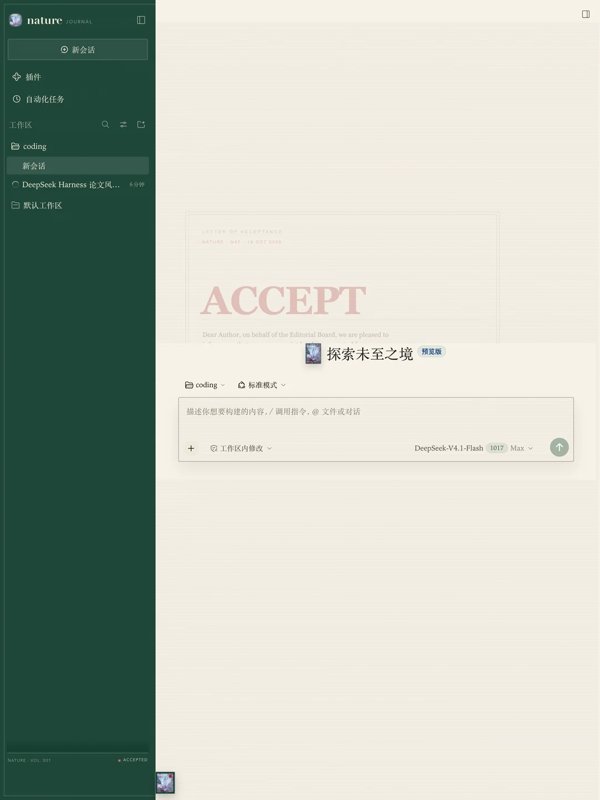
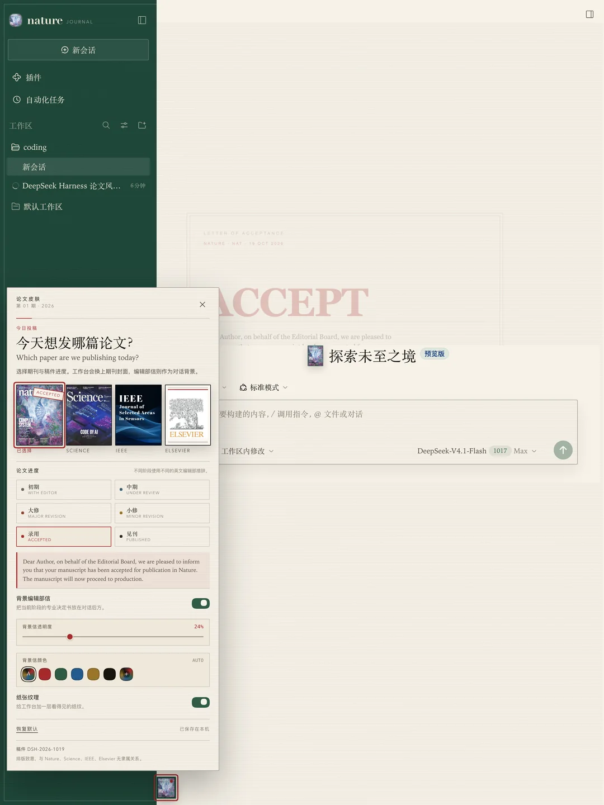

# Paper Skin · Journal Desk

A quiet, scholarly skin for **DeepSeek Harness**. Choose the paper you are publishing today — *Nature*, *Science*, *IEEE* or *Elsevier* — set the manuscript stage, and a professional editorial letter settles behind the conversation.

> A typographic homage only. This project is not affiliated with Nature, Science, AAAS, IEEE or Elsevier.



## What it does

- **Journal masthead.** The sidebar becomes a deep cover-coloured spine with a typographic wordmark, a circular cover thumbnail, a journal descriptor and a slim colophon showing volume and stage.
- **Four covers.** Pick a journal from the small journal-cover button beside Harness **Settings**. The lower-left sidebar carries a slim colophon instead of a bulky journal switcher.
- **Manuscript progress.** Choose the stage in the same skin panel:
  - **初审 · With Editor** — initial editorial assessment
  - **中期 · Under Review** — peer review
  - **大修 · Major Revision** — revise and resubmit
  - **小修 · Minor Revision** — minor revision anticipated
  - **录用 · Accepted** — formal letter of acceptance
  - **见刊 · Published** — final article online
- **A professional letter, behind the conversation.** The selected stage renders a letter as the conversation background: a large stage word, editorial-office wording, manuscript number, date and a circular seal. It is a real CSS background layer, not a composer banner. Its visibility is adjustable from **5% to 80%**, and its colour can follow the manuscript stage or be set from a palette or the custom colour picker.
- **Journal artwork.** All four covers use the artwork in `assets/`: the Nature, Science and IEEE covers, and the Elsevier tree plus wordmark. The same artwork appears in the small journal button, the hero seal and the sidebar mark.
- **Visible paper grain.** A laid-paper texture runs across the conversation, composer, settings panel and sidebar, and can be switched off entirely.
- **Light & dark.** Paper, cover ink and watermark adapt to the Harness colour scheme.
- **Local only.** Choices live in this browser’s `localStorage` under `dsh.paper-skin.v1`. The skin makes no external network requests and collects no data.



## Use

After installation, reload the page once.

1. The small journal-cover button sits beside Harness **Settings** at the lower left.
2. Click it to choose a journal and a manuscript stage.
3. The sidebar, cover colour, typography and the editorial letter behind the conversation change together.
4. `Accepted` uses a formal letter of acceptance; every other stage uses the corresponding editorial-office language.

The floating quick-settings pattern takes after [open-sea-skin](https://github.com/d-dev0101/open-sea-skin); the panel and skin here are an independent implementation. `open-sea-skin` is not required.

## Install

Paper Skin is a self-contained DeepSeek Harness bundle: one Host row (`paper-skin`), one Web client module, and a read-only local asset route. There are no runtime dependencies and no build step.

### From GitHub

Install the tagged release straight from the public repository:

```sh
dsh plugin --profile desktop add github:1552421144-cloud/paper-skin#v1.0.0
```

Or open Harness **Plugins → Add plugin → Install a third-party plugin**, paste the same `github:...` spec, install, then enable **Paper Skin · Journal Desk**.

### From a release tarball

Download `paper-skin-1.0.0.tgz` from the [release page](https://github.com/1552421144-cloud/paper-skin/releases), then install it into the same profile that runs Harness:

```sh
dsh plugin --profile desktop add /absolute/path/to/paper-skin-1.0.0.tgz
```

For the macOS Desktop app, the bundled CLI is:

```sh
"/Applications/DeepSeek Harness.app/Contents/Resources/runtime/cli/bin/dsh" \
  plugin --profile desktop add /absolute/path/to/paper-skin-1.0.0.tgz
```

Restart Harness, reload the page once, then open **Plugins** and confirm **Paper Skin · Journal Desk** is enabled. The bundle row is `paper-skin`.

### From npm

Once the package is published to npm, install an exact version:

```sh
dsh plugin --profile desktop add paper-skin@1.0.0
```

Or open Harness **Plugins → Add plugin**, enter `paper-skin@1.0.0`, install, and enable **Paper Skin · Journal Desk**.

### From a checkout

For development against a working copy:

```sh
dsh plugin --profile desktop add "link:/absolute/path/to/paper-skin"
```

## Uninstall

Remove **Paper Skin** in **Plugins**, or:

```sh
dsh plugin --profile desktop remove paper-skin
```

Unloading removes the CSS, root attributes, background watermark and every slot entry. The localStorage key remains until cleared.

## Compatibility

Verified against DeepSeek Harness Desktop **0.2.1-rc.2** on macOS. The client half uses the standard Web slots listed below, so it also works in a `dsh web` profile that has the same client packages. It does not modify the Harness checkout.

## Files

| File | Purpose |
| --- | --- |
| `client.js` | Browser skin: React slots, covers, stage letters, colour and opacity controls, CSS and the settings panel. |
| `index.js` | Host half; serves the cover artwork from `assets/`. It registers no tools, model context or session routes. |
| `cordis.patch.yml` | Bundle patch inserting the `paper-skin` row. |
| `locale/*.json` | Plugin-manager metadata (English and Chinese). |
| `icon.svg` | Original journal-cover icon. |
| `assets/*` | Optimised Nature/Science/IEEE covers, the Elsevier cover, and the transparent Elsevier tree mark. |
| `docs/*.webp` | Screenshots used by this README. |
| `THIRD_PARTY_NOTICES.md` | Trademark and artwork attribution. |

## Slots

- `sidebar.brand.mark`, `sidebar.brand.name`
- `sidebar.footer.action` (slim colophon, not a switcher)
- `conversation.hero.brand.mark`
- `shell.overlay` (the only journal/stage switcher)

The conversation letter is a CSS background on the transcript surface; it adds no transcript rows. Cover artwork is served locally by the Host half from `assets/`. No app-root replacement, no external network requests.

## Packaging a release

```sh
npm pack
```

The resulting `paper-skin-1.0.0.tgz` contains only the runtime files, locales, icon, artwork, screenshots and documentation. The repository and release are at [1552421144-cloud/paper-skin](https://github.com/1552421144-cloud/paper-skin). Publishing to npm is optional and would allow installation by package name:

```sh
npm publish
```

## Licence

MIT for the plugin code. Journal and publisher names and the cover artwork are used descriptively; they are not official endorsements, and the artwork is not covered by the MIT licence. See [THIRD_PARTY_NOTICES.md](THIRD_PARTY_NOTICES.md). All trademarks remain with their owners.
